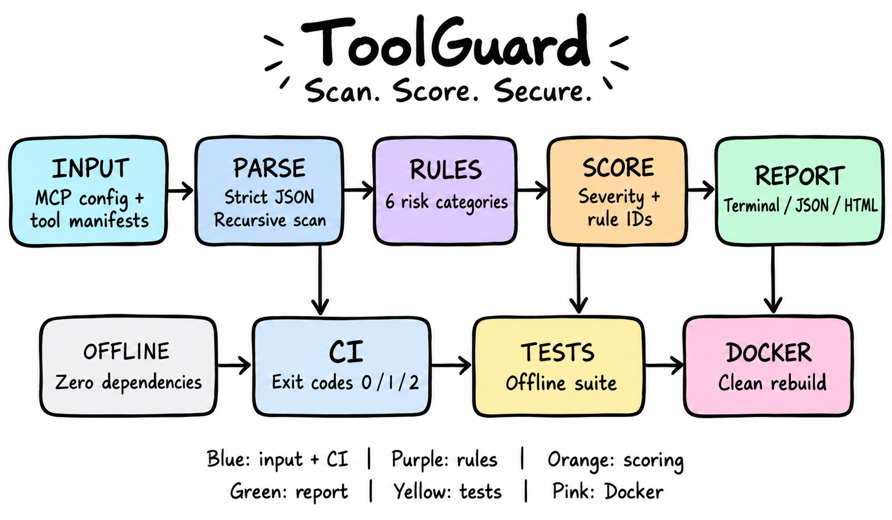

# ToolGuard

**Scan. Score. Secure.**



ToolGuard is an offline Node.js 22 CLI that statically scans MCP configurations and tool manifests, reports suspicious configuration patterns, and produces terminal, JSON, or self-contained HTML results.

## How ToolGuard clears the bar

| Judging criterion | Concrete proof in this repository | How to verify |
|---|---|---|
| **It works** | CLI entry point: `bin/toolguard.js`; implementation: `src/toolguard.js`; fixtures: `test/fixtures/`; examples: `examples/clean/` and `examples/malicious/` | Run `npm ci`, `npm test`, and scan both examples. Use actual command output for test counts and scan totals. |
| **It's worth using** | Recursive JSON scanning, rule-based findings, terminal/JSON/HTML formats, and exit codes for automation | Run clean and malicious scans, then inspect the JSON and HTML reports. |
| **It rebuilds** | `Dockerfile`, `package-lock.json`, `.nvmrc`, and offline Docker commands | Build the image and run the test suite with networking disabled. An offline build requires the base image and build inputs to be available locally. |
| **OmniRush built it** | Plan-first implementation workflow with targeted scanner, clean-clone, and report reviews | Review the OmniRush session notes and Git history for specific findings and fixes. |

## Contents

- [The problem](#the-problem)
- [What it detects](#what-it-detects)
- [How it works](#how-it-works)
- [Example output](#example-output)
- [Quickstart](#quickstart)
- [Reproducibility and verification](#reproducibility--verification)
- [CI usage](#ci-usage)
- [How it was built with OmniRush](#how-it-was-built-with-omnirush)
- [Assumptions and honest limitations](#assumptions--honest-limitations)
- [Repository layout](#repository-layout)
- [Command reference](#command-reference)

## The problem

MCP clients can load server configurations and tool descriptions supplied by third parties. Those descriptions and configuration values can influence which tools an AI agent chooses and how it uses them.

A misleading tool description can attempt to steer an agent toward unrelated actions. This is often called **tool poisoning**. Configuration files can also expose secrets, specify risky launch settings, or reference packages without pinning a known version.

If these inputs are not reviewed, a risky configuration may be accepted before a tool is ever called.

ToolGuard provides a local, static check before configurations are used. It is designed not to start configured MCP servers or connect to their URLs.

## What it detects

ToolGuard evaluates input using the rules implemented in `src/toolguard.js`. Findings include rule identifiers and severity information.

The exact rule IDs, categories, and severity definitions must match the current source code. The following table is a template to complete after reviewing the implementation and the actual output from `examples/malicious`.

| Rule ID | Category | Severity | Example signal | Remediation |
|---|---|---|---|---|
| Verify from source | Tool metadata / tool poisoning | Verify from source | Suspicious or misleading tool description, if covered by a rule | Review the tool description and confirm it comes from a trusted source. |
| Verify from source | Secrets | Verify from source | A configuration value that resembles a credential, if covered by a rule | Remove exposed credentials, rotate compromised secrets, and use a suitable secret store. |
| Verify from source | Package pinning / supply chain | Verify from source | An unpinned package reference, if covered by a rule | Pin a reviewed package version and use lockfile-based installation. |
| Verify from source | Command / launch configuration | Verify from source | A risky configured command, if covered by a rule | Review the executable and arguments. Allow only trusted commands that are required. |
| Verify from source | URL / endpoint configuration | Verify from source | A concerning configured host or URL scheme, if covered by a rule | Verify the destination and use an appropriate trusted transport. |
| Verify from source | Remaining implemented category | Verify from source | Replace this row with the actual sixth category and a real fixture example. | Add the remediation appropriate to the implemented rule. |

**Important:** These are documentation categories to investigate, not a verified list of implemented detection rules. Before submission, replace the provisional entries with the exact IDs, categories, severities, examples, and remediations from the source and tests.

## How it works

```text
MCP config / tool manifest
           |
           v
     Strict JSON parsing
           |
           v
      Recursive scan
           |
           v
      Rule evaluation
           |
           v
 Findings + severity + rule IDs
           |
           v
 Terminal / JSON / HTML report
```

Directories are scanned recursively for `.json` files. `.git`, `node_modules`, and symlinked directories are skipped.

Explicit files are scanned regardless of extension, but their contents must be strict JSON. JSONC, YAML, and JavaScript are intentionally not evaluated.

The scan is offline by design: configured commands are not executed and configured URLs are not fetched.

### Exit codes

| Code | Meaning |
|---:|---|
| `0` | Scan completed with no findings |
| `1` | Scan completed with one or more findings |
| `2` | Usage, input, decoding, or JSON parsing error |
| `3` | Unexpected internal error |

## Example output

Run a scan against the malicious example:

```sh
node bin/toolguard.js scan examples/malicious --format terminal
```

Use the real terminal output from this command when documenting example findings. Do not invent finding counts or severity totals.

Generate an HTML report:

```sh
node bin/toolguard.js scan examples/malicious --format html --output report.html
```

The HTML format is intended to be self-contained, with inline CSS and no external resources.

**Sample HTML report:** [View the sample report](./docs/index.html)

Confirm that `docs/index.html` is the actual sample report before publishing. If the project uses a different sample-report path, preserve and link to that existing report instead.

## Quickstart

ToolGuard requires Node.js 22.

With `nvm`, select the checked-in Node.js version and install from the lockfile:

```sh
nvm use
npm ci
```

If `nvm` is unavailable, install Node.js 22 directly and confirm it with:

```sh
node --version
```

### Scan the clean example

```sh
node bin/toolguard.js scan examples/clean --format terminal
```

### Scan the malicious example

```sh
node bin/toolguard.js scan examples/malicious --format terminal
```

### Run the tests

```sh
npm test
```

### Run the demo

```sh
npm run demo
```

Confirm that `demo` exists in `package.json`. You can list the available npm scripts with:

```sh
npm run
```

### Other usage patterns

Scan a JSON fixture:

```sh
node bin/toolguard.js scan test/fixtures/clean.json
```

Write a JSON report:

```sh
node bin/toolguard.js scan examples/clean --format json --output toolguard-report.json
```

Write an HTML report:

```sh
node bin/toolguard.js scan examples/clean --format html --output toolguard-report.html
```

Scan strict JSON from standard input:

```sh
cat test/fixtures/clean.json | node bin/toolguard.js scan --stdin --stdin-name manifest.json
```

To use the package through a local npm link:

```sh
npm link
toolguard scan examples/clean --format terminal
```

Use `--root DIR` to control the relative paths shown in reports.

## Reproducibility & verification

ToolGuard is designed for offline scanning and deterministic reporting. Its output should not depend on timestamps, host-specific runtime information, network responses, or random identifiers.

Verify deterministic output by running the same scan twice with the same input and comparing the generated reports.

### Test and Docker gate

Run the tests locally:

```sh
npm test
```

Build the image:

```sh
docker build -t toolguard .
```

Run the tests inside the container without network access:

```sh
docker run --rm --network none toolguard npm test
```

Combined gate:

```sh
docker build -t toolguard . && docker run --rm --network none toolguard npm test
```

The Dockerfile uses `CMD` rather than an entrypoint, so provide the full command when running the CLI inside the image:

```sh
docker run --rm --network none toolguard node bin/toolguard.js scan examples/clean --format terminal
```

### Fully offline Docker rebuild

To rebuild without network access, using a locally cached base image and available build inputs:

```sh
docker build --pull=false --network=none -t toolguard:22-offline .
docker run --rm --network=none toolguard:22-offline npm test
```

The base image must already be available locally. Docker cannot pull missing images while the build is running with network access disabled.

### Clean-clone verification

Run the following commands from a fresh checkout:

```sh
git clone <REPOSITORY-URL> ToolGuard
cd ToolGuard
nvm use
npm ci
npm test
node bin/toolguard.js scan examples/clean --format terminal
node bin/toolguard.js scan examples/malicious --format terminal
```

Replace `<REPOSITORY-URL>` with the actual repository URL.

Record the real test summary and scan output from the clean clone when preparing a release or submission.

## CI usage

Save the following workflow as `.github/workflows/toolguard.yml` in the repository you want to protect.

Replace `examples/clean` with the directory containing the MCP configuration you want to scan.

```yaml
name: ToolGuard

on: [push, pull_request]

jobs:
  scan:
    runs-on: ubuntu-latest

    steps:
      - uses: actions/checkout@v4

      - uses: actions/setup-node@v4
        with:
          node-version-file: .nvmrc
          cache: npm

      - run: npm ci
      - run: npm test
      - run: node bin/toolguard.js scan examples/clean --format terminal
```

The workflow runs the test suite and scans the selected configuration directory. Review the behavior of the exit codes before making this a required merge gate.

## How it was built with OmniRush

The intended workflow was **plan first, implement, verify, and review**. The focus was on making the CLI contract clear, testing it against fixtures, and checking the documentation against behavior rather than relying only on a successful demonstration.

The targeted review passes were:

- **Adversarial scanner review:** examine whether misleading or malicious configurations could evade the static rules and whether the fixtures exercise the intended detections.
- **Clean-clone README review:** check whether installation, tests, scans, Docker, and CI instructions can be followed from a fresh checkout.
- **XSS and accessibility review:** examine HTML report generation for unsafe handling of untrusted input and review the report's accessibility and usability.

For a judge-friendly, auditable account, document each review as:

**Finding → Fix → Regression test**

Use the actual review notes and Git history to fill in the findings and corresponding fixes. Do not claim a specific vulnerability was fixed unless the repository history or review evidence supports it.

## Assumptions & honest limitations

- **Static analysis only:** ToolGuard inspects configuration and manifest data. It does not prove what an MCP server will do at runtime.
- **No live server connection:** configured commands are not executed and configured URLs are not fetched during a scan.
- **Heuristic rules can be imperfect:** a rule can flag benign configuration (a false positive) or miss a harmful pattern (a false negative).
- **Not a replacement for a security audit:** verify the provenance of servers, apply least-privilege principles, review findings, and perform a broader security assessment for sensitive environments.
- **JSON only:** JSONC, YAML, and JavaScript are not evaluated. Inputs must be strict JSON.
- **Offline rebuilds have prerequisites:** a fully offline Docker build requires locally cached base images and all required build inputs.
- **Rule coverage must be precise:** rule IDs, categories, severity values, and test coverage should come from the implementation, not from the architecture diagram.
- **Results must be reproducible:** use actual output from the final checkout for test totals, finding counts, and example reports.

## Repository layout

```text
ToolGuard/
├── bin/
│   └── toolguard.js
├── src/
│   ├── cli.js
│   └── toolguard.js
├── docs/
│   ├── a3c4800c-41fe-4ff0-a2c2-a6b0ee3e219f.png
│   ├── index.html
│   └── report-screenshot-placeholder.svg
├── examples/
│   ├── clean/
│   └── malicious/
├── scripts/
├── test/
│   ├── fixtures/
│   │   ├── clean.json
│   │   ├── invalid.json
│   │   └── risky.json
│   └── toolguard.test.js
├── .dockerignore
├── .env.example
├── .gitignore
├── .nvmrc
├── Dockerfile
├── package-lock.json
├── package.json
└── README.md
```

## Command reference

| Command | Purpose |
|---|---|
| `nvm use` | Select the Node.js version specified by `.nvmrc` |
| `npm ci` | Install reproducibly from `package-lock.json` |
| `npm test` | Run the offline test suite |
| `npm run demo` | Run the demo, if defined in `package.json` |
| `node bin/toolguard.js scan examples/clean --format terminal` | Scan the clean example |
| `node bin/toolguard.js scan examples/malicious --format terminal` | Scan the malicious example |
| `node bin/toolguard.js scan PATH --format json --output report.json` | Write a JSON report |
| `node bin/toolguard.js scan PATH --format html --output report.html` | Write an HTML report |
| `cat FILE.json \| node bin/toolguard.js scan --stdin --stdin-name manifest.json` | Scan strict JSON from standard input |
| `docker build -t toolguard .` | Build the Docker image |
| `docker run --rm --network none toolguard npm test` | Run tests without container network access |
| `docker build --pull=false --network=none -t toolguard:22-offline .` | Attempt an offline build using locally cached inputs |

---
